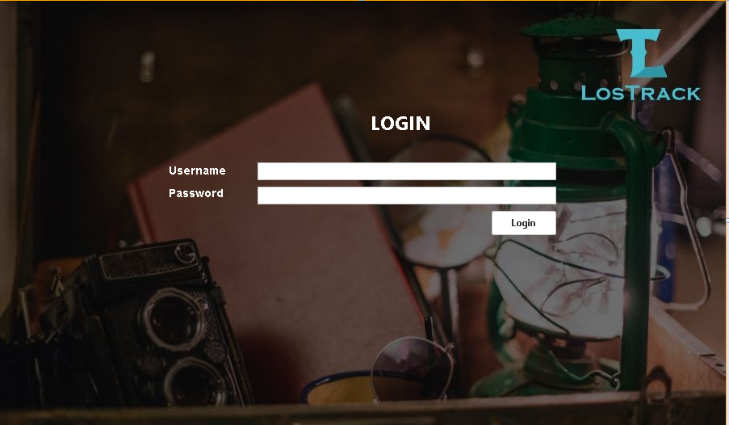
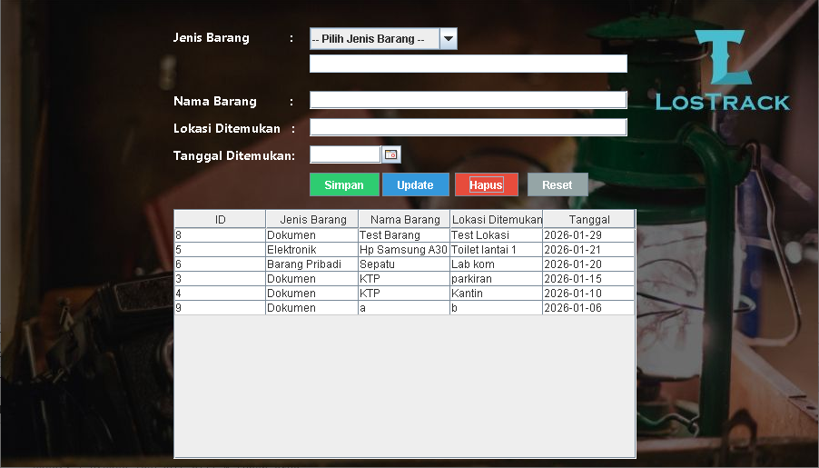

# LostTrack

LostTrack is a desktop-based application designed to manage lost and found item records within a campus environment.

The application helps manage information about found items, making it easier to record and track items reported on campus.

## Screenshots

### Login


### Main Menu


## Features

- User login
- Add found-item records
- View recorded items
- Update item information
- Delete records with confirmation
- Reset input fields

## Built With

- Java 21
- Java Swing
- MySQL
- MySQL Connector/J
- JCalendar
- Maven

## Getting Started

### Requirements

- JDK 21 or later
- MySQL Server
- Apache Maven

### Installation

1. Clone this repository:

   ```bash
   git clone https://github.com/dulcodingz/Lostrack-crud.git
   ```

2. Open the project using NetBeans or another Java IDE that supports Maven.

3. Configure the MySQL database connection.

4. Build and run the project.

---

**Project:** University Coursework  
**Repository:** [dulcodingz/Lostrack-crud](https://github.com/dulcodingz/Lostrack-crud)
